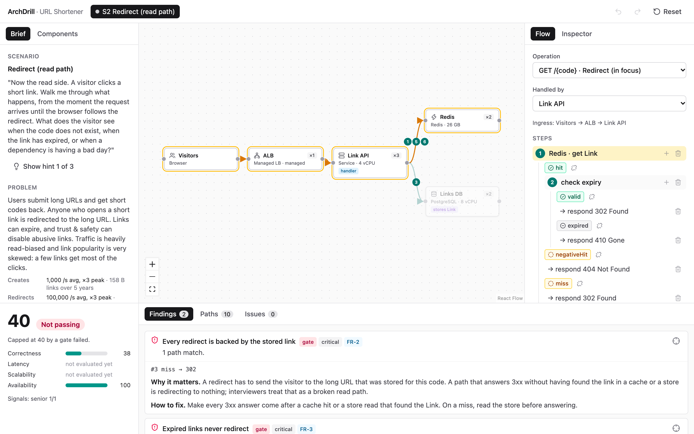
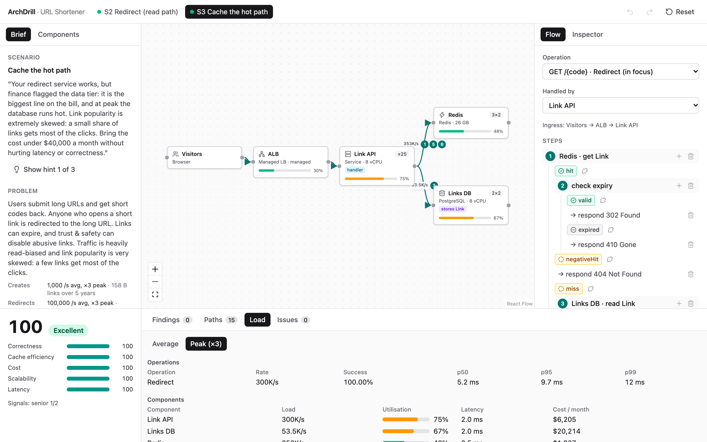
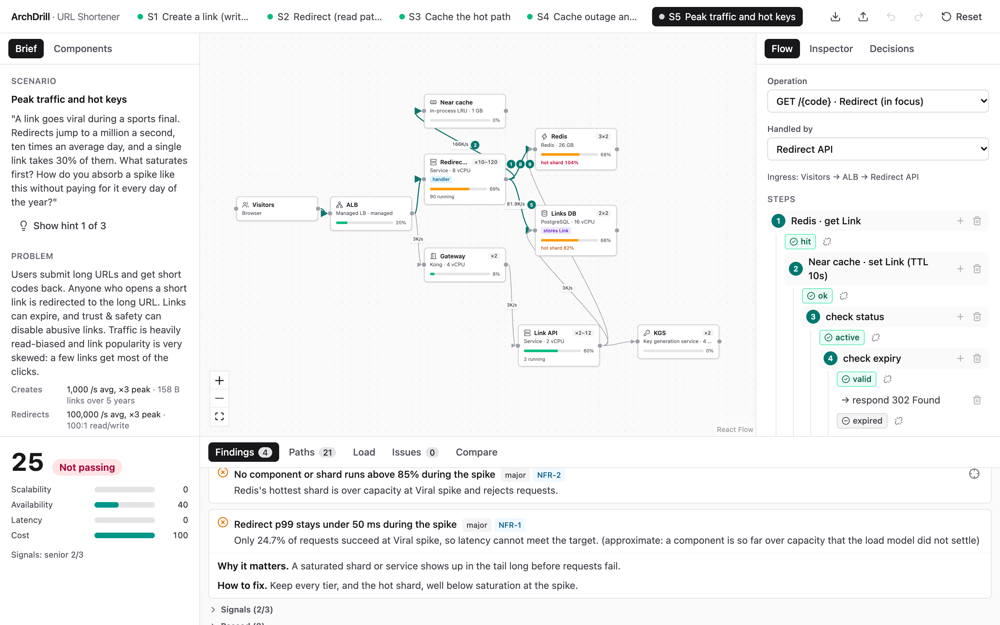
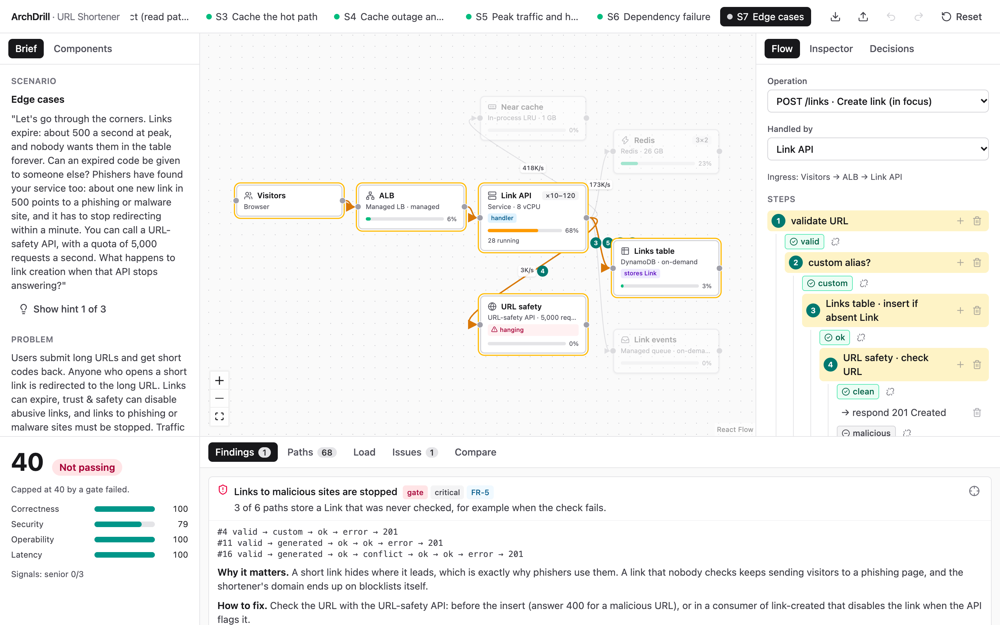
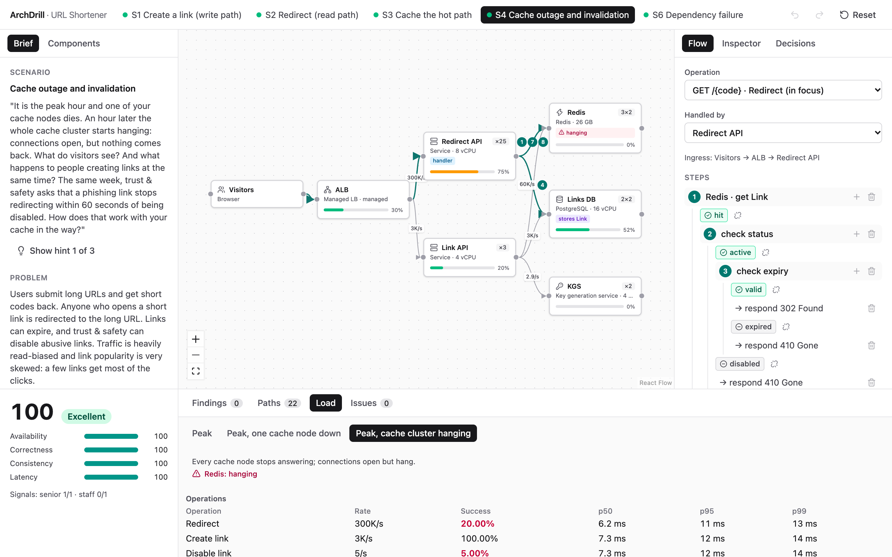
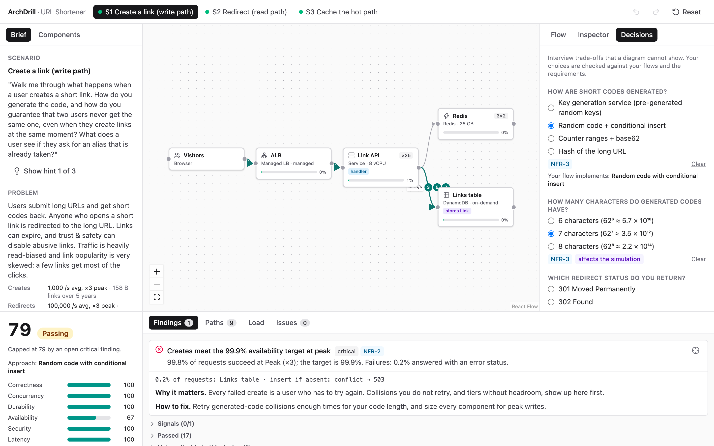

# ArchDrill

Scenario-based system design practice with deterministic simulation and evaluation.

You design **one architecture** for a problem, then drive it through **scenarios**: write path, read path, caching, peak traffic, failures, and edge cases. Each scenario is evaluated on how the design *behaves*, not on which component names appear. The analysis covers paths, data flow, configuration, and simulated load and faults, and every finding points at the part of the canvas that caused it.

> **Status:** v0.1 (M1 to M7), v0.2 (M8 to M11) and v0.3 (M12 to M17) are complete: five problem packs, each with scenarios, golden designs and mutants held by CI. Eight URL Shortener scenarios run end to end (write path, read path, caching, cache outage and invalidation, peak traffic and hot keys, dependency failure, edge cases, click analytics): design, record, analyse, simulate, score, explain. v0.1 built the core: analytic simulation, write-path strategies, faults, timeouts and retries, scale, asynchronous work, and hardening (evaluation in a worker, budgets, reports and browser tests in CI). v0.2 added time: timelines with cache warm-up, autoscaling lag, breaker waits and backlogs, a timeline view with predictions and a scrubber, click analytics with stream aggregation and hot counters, and an estimation gym. See the [roadmap](docs/design/07-roadmap.md).



## Why

Most system design practice tools reward placing familiar components (a cache, a queue, a CDN) on a canvas. Interviews reward knowing what happens on a cache miss, when the cache is down, when two users create the same short code at the same time, or when a link goes viral. ArchDrill evaluates those behaviours:

- **Flows with branches.** Requests are recorded through the topology with explicit outcomes (hit/miss, found/notFound, conflict, error), and every resulting path is analysed.
- **Capability-based checks and strategies.** Several valid designs are accepted (for example KGS, random codes with conditional writes, or obfuscated counter ranges for unique codes).
- **Analytic simulation.** Cache memory drives the hit ratio, the hit ratio drives database load, and database load drives p99, cost, and survival under faults.
- **A trustworthy evaluator.** A golden corpus of valid designs must pass and a mutant corpus of broken designs must fail. Both are enforced in CI.

## What works today

- **Topology editor:** components from a catalog (clients, load balancers, API gateways, services, Redis/Memcached, PostgreSQL/MySQL, DynamoDB, Cassandra, key generation services, etcd/ZooKeeper, managed queues/Kafka, a Flink stream processor, a URL-safety API), connections, sizes, replicas, shards and entity bindings.
- **Flow recorder:** each operation's flow is recorded step by step, with every outcome (hit, negativeHit, miss, found, notFound, expired, conflict, malicious, error) as an explicit branch. Operations start from a client request, from an event a consumer takes off a queue, or from a schedule.
- **Several valid write paths:** a key generation service, random codes with conditional inserts, counter ranges with obfuscation, or URL hashes. The evaluator names the approach a flow implements and checks it against the declared decision, and catches the check-then-insert race.
- **Decisions:** interview trade-offs such as code strategy, code length, redirect status and replication mode. Some feed the simulation: code length sets the keyspace, and with it the collision rate; replication mode sets write latency and what a failover loses.
- **Scale:** a viral link's traffic lands on the one cache shard that holds it, in-process near caches absorb it, and services autoscale between an average-day minimum and a spike maximum, so the simulation shows both the hot shard and what the spike costs on an ordinary day.
- **Asynchronous work:** a create flow publishes `link-created`; a consumer scans new links with a third-party URL-safety API and disables malicious ones; a scheduled job purges expired links in batches. The simulation derives each consumer's rate from what is published, redelivers failed messages until they are dead-lettered, and shows lag and backlog when workers fall behind. Scanning before answering and scanning in a consumer both pass, each with its own trade-offs.
- **Timelines:** how a design behaves second by second. A cache restarts empty and fills up again, a viral link grows traffic tenfold while new instances take a minute to start, a database fails over, and a bulk import outruns a scanner. Charts show success rate, p99, utilisation, running instances, hit ratios and backlogs, with an event log; checks ask for recovery within a time. Before a timeline is shown, it asks what you expect (how busy the store gets, how long recovery takes) and puts your answer next to what happened. A scrubber shows the canvas at any moment, along with how requests went then: each path's share, status and latency. Timelines surface effects no steady state shows, such as a consumer kept overloaded by its own redeliveries after the burst has passed.
- **Click analytics:** every redirect is a click, 300,000 a second at peak and 100,000 a second on a viral link. Redirects publish clicks fire-and-forget into a bounded buffer; a consumer sums them per link over a window and writes in batches. The simulation shows why windows help less than expected (most links in a window are clicked once), how a viral link's increments throttle one partition, and what per-message pricing costs at this volume. Checks ask that redirects never wait for a write, that counts stay a minute fresh, and that a redelivered click is not counted twice.
- **Estimation gym:** back-of-envelope questions (links a day, storage over five years, peak redirects, the code space, cache memory, click-log bandwidth), answered the way you would on a whiteboard (`86M`, `79 TB`, `3.5 × 10^12`) and judged spot on, close or off, with the derivation once you have answered.
- **Faults and call policies:** environments break components by role (a cache node down, the whole cache hanging, a database failing over, a server crashing). Every call a service makes follows its connection's policy (timeout, retries with backoff and jitter, circuit breaker, bulkhead), so the simulation shows miss storms, cascades through shared databases, retry storms and the latency a hanging dependency costs.
- **Path explorer:** every path a request can take, with its outcome sequence and final status. Hovering a path highlights it on the canvas.
- **Analytic simulation:**
  - cache hit ratios from memory, TTL and Zipf-skewed popularity;
  - code collisions from keyspace occupancy, and the retries needed to absorb them;
  - faults, timeouts, retries, circuit breakers and bulkheads, including retry storms that a cache flush leaves the design stuck in;
  - exact M/M/c queueing and latency percentiles over every path;
  - overload that cascades through fallbacks;
  - monthly cost, including storage for every replica's copy.
- **Load view:**
  - per environment (average, peak): operations, components, caches, cost breakdown;
  - utilisation on the canvas and request rates on connections.
- **Evaluator:** gates, severity caps, weighted dimensions, senior signals, and findings that say what was checked, what was found, why interviewers care, and how to fix it.
- **Working across scenarios:** a change that lowers another scenario's score raises a warning on that scenario's tab; a pinned baseline shows how every score moved and what changed; debriefs pose the follow-up questions once a scenario passes; designs export and import as JSON, upgraded by versioned migrations.
- **Five problems:** a picker in the header switches between the URL shortener, a distributed rate limiter, a news feed, chat and notifications, and orders and payments. Each keeps its own design.
- **Compare mode:** run the current design and a pinned baseline, or a second design loaded from a file, through every scenario, with scores and costs side by side.
- **Authoring:** JSON Schemas for every kind of content file, so editors complete fields and flag mistakes; facts, counts and entity rules let new problems reuse the engine.
- **Tests:**
  - over 540 unit, integration and property tests, including the product's success criteria;
  - a golden corpus of seven valid designs and 79 mutants that CI must catch;
  - Playwright tests that walk the core loop in a real browser, and run the production build under its security headers;
  - a corpus report and an evaluation-time budget published by CI.











## Problems

| Problem | Scenarios | What it teaches |
|---|---|---|
| [URL Shortener](docs/problems/url-shortener.md) | S1–S8 | Unique codes, caching under Zipf popularity, outages, hot keys, failover, asynchronous work, timelines, click analytics |
| [Distributed Rate Limiter](docs/problems/rate-limiter.md) | S1–S3 | Counting on every request, fleet-wide limits, window algorithms, failing open with a fallback, a runaway client on one shard |
| [News Feed](docs/problems/news-feed.md) | S1–S3 | Fan-out on write or read, celebrity accounts and the hybrid model, timeline caches, cursor pagination, rebuild storms |
| [Chat and Notifications](docs/problems/chat.md) | S1–S3 | Millions of open connections, delivery and push notifications, idempotent resends, per-conversation ordering, large groups, presence |
| [Orders and Payments](docs/problems/payments.md) | S1–S3 | Idempotency keys, sagas and compensation, the transactional outbox, exactly-once fulfilment, ambiguous timeouts and reconciliation |

Switch problems from the picker in the header; each problem keeps its own design in the browser.

## Guides

| Guide | Contents |
|---|---|
| [How scoring works](docs/guides/scoring.md) | Checks, dimensions, gates and caps, bands, signals |
| [About the model](docs/guides/model.md) | What the simulation computes, what it assumes, and when numbers are approximate |
| [Authoring a problem pack](docs/guides/authoring.md) (draft) | Problems, scenarios, workloads, checks, golden designs and mutants |

## Design documents

| Doc | Contents |
|---|---|
| [01 Product](docs/design/01-product.md) | Vision, core loop, principles, goals, success criteria |
| [02 Domain model](docs/design/02-domain-model.md) | Catalog, capabilities, actions and outcomes, problem packs, scenarios, attempts, flows |
| [03 Evaluation](docs/design/03-evaluation.md) | Pipeline, path analysis, check library, strategies, scoring, feedback, reliability |
| [04 Simulation](docs/design/04-simulation.md) | Analytic engine (cache, queueing, latency mixtures, retries, faults, cost) and DES |
| [05 UX](docs/design/05-ux.md) | Layout, modes, flow recorder, results dock, cross-scenario awareness |
| [06 Architecture](docs/design/06-architecture.md) | Stack, packages, data flow, persistence, testing, CI |
| [07 Roadmap](docs/design/07-roadmap.md) | Milestones and acceptance criteria |
| [URL Shortener](docs/problems/url-shortener.md) | The first problem pack: scenarios S1–S8, golden designs, mutants |
| [ADRs](docs/adr/) | Architecture decision records |

## Development

Requires Node.js ≥ 22 and pnpm 10.

```bash
pnpm install
pnpm dev         # web app on http://localhost:5173
pnpm test        # unit, integration and corpus tests (Vitest)
pnpm e2e         # browser tests (Playwright; uses the installed Chrome locally)
pnpm report      # corpus report and the evaluation-time budget (Markdown in packages/content/report/out)
pnpm check       # Biome lint/format check + TypeScript
pnpm build       # production build
pnpm serve       # build and serve the production build on 127.0.0.1:4173
```

### Running it at home over Tailscale

`pnpm serve` builds the app and serves the production build on `127.0.0.1:4173`, with a strict content security policy; a Playwright test runs that build under the same headers. To keep it running on a Mac and reach it from your other devices:

```bash
cp deploy/local/com.mecemis.archdrill.web.plist ~/Library/LaunchAgents/
launchctl bootstrap gui/$(id -u) ~/Library/LaunchAgents/com.mecemis.archdrill.web.plist
tailscale serve --bg --https=10000 http://127.0.0.1:4173
```

The app is then at `https://<machine>.<tailnet>.ts.net:10000`, for devices on your tailnet only. After pulling new code, `launchctl kickstart -k gui/$(id -u)/com.mecemis.archdrill.web` rebuilds and restarts it; the log is `~/Library/Logs/archdrill-web.log`.

## License

[MIT](LICENSE)
