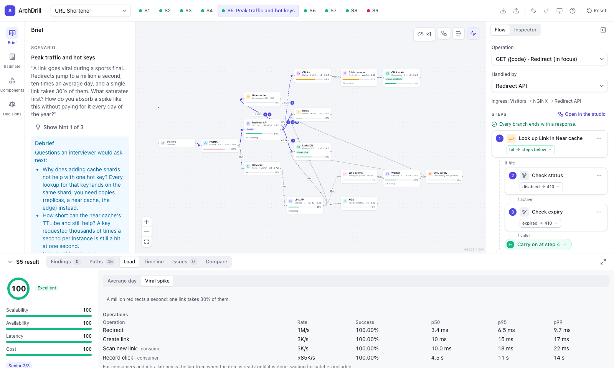
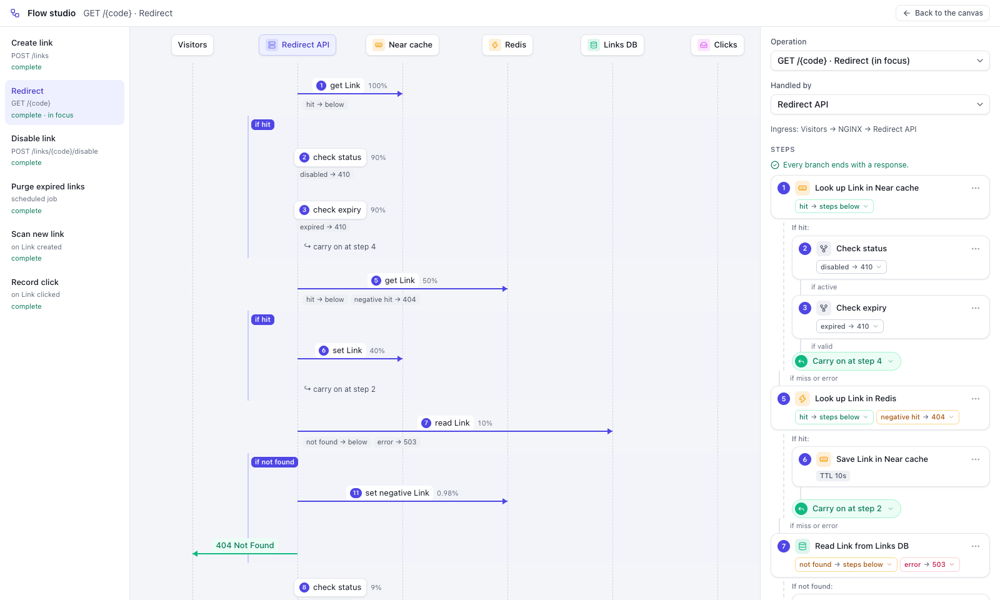
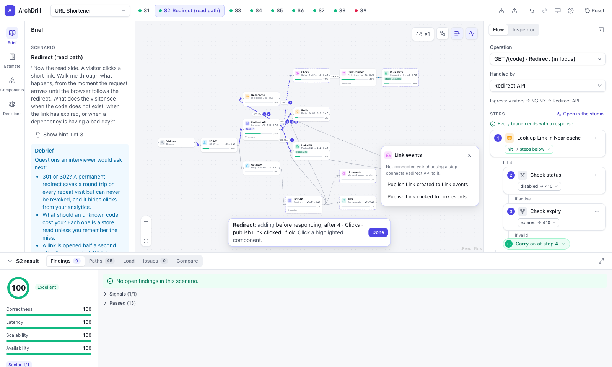
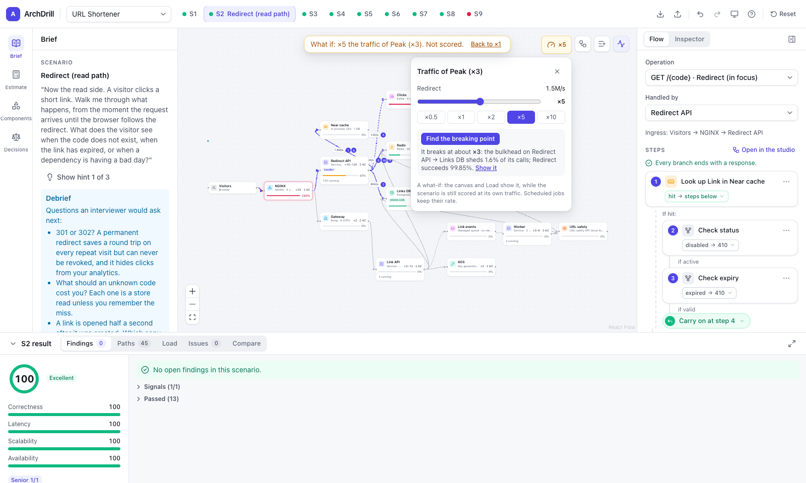
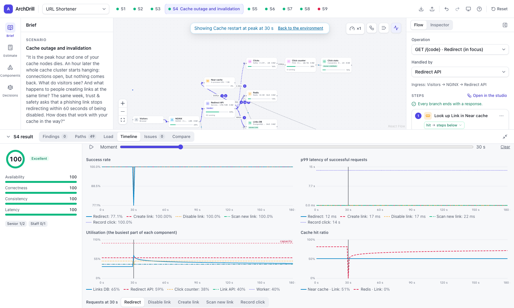
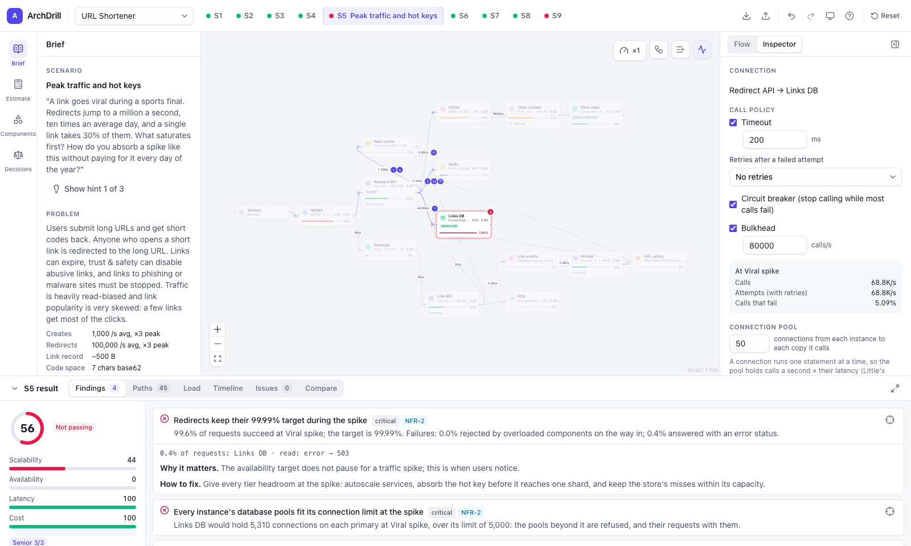

# ArchDrill

Scenario-based system design practice with deterministic simulation and evaluation.

**Try it: [mecemis.github.io/archdrill](https://mecemis.github.io/archdrill/)**. It runs entirely in your browser: no account, and your designs never leave it.

You design **one architecture** for a problem, then drive it through **scenarios**: the write path, the read path, caching, peak traffic and hot keys, failures, losing a zone or a region, and edge cases. Each scenario is evaluated on how the design *behaves*, not on which component names appear. Paths, data flow, configuration, and simulated load and faults are all analysed, and every finding points at the part of the design that caused it.



## Why

Interviews reward knowing what happens on a cache miss, when the cache is down, when two users create the same short code at the same time, or when a link goes viral. ArchDrill evaluates those behaviours:

- **Flows with branches.** Each operation's flow is recorded through the design with explicit outcomes (hit, miss, found, not found, conflict, error), and every path a request can take is analysed.
- **Several valid answers.** A key generation service, random codes with conditional writes, or obfuscated counter ranges all pass. The evaluator names the approach a flow implements and checks it against the declared decision.
- **A simulation with consequences.** Cache memory drives the hit ratio, the hit ratio drives database load, and database load drives p99, cost, and survival under faults.
- **One design across every scenario.** A replica added for reads shows up in the budget, and a failover choice shows up in read latency. Changing the design re-evaluates every scenario and flags any it made worse.
- **A trustworthy evaluator.** Golden designs must pass and mutants (designs broken in one specific way) must fail, enforced in CI.

## What you can do

### Design

- **Components from a sourced catalog:** clients, load balancers, API gateways, services, Redis and Memcached, near caches, PostgreSQL and MySQL, DynamoDB, Cassandra, S3 object storage, key generation services, etcd and ZooKeeper, managed queues and Kafka, a Flink stream processor, and third-party APIs. Every capacity, latency and price cites the vendor source it was read from, with the date, or states how it is modelled.
- **Placement:** sizes, replicas, shards and autoscaling bounds; instances spread over availability zones; a standby copy in a second region, or both regions taking traffic; an RDS Proxy in front of a database.
- **Decisions:** interview trade-offs such as the code strategy, code length, redirect status, replication mode and region mode. Many feed the simulation. For example, code length sets the keyspace and with it the collision rate, and replication mode sets write latency and what a failover loses.

### Describe what the services do

- **A flow per operation:** requests from a client, messages a consumer takes off a queue, or a scheduled job. Each step calls a component (look up, read, insert if absent, publish) or decides something (check expiry, validate the URL), and every outcome leads somewhere.
- **Four ways to build a flow:**
  - **A list** in the Flow panel, with the likely next steps first.
  - **The canvas:** click a component and its steps open next to it, then click your way along the path.
  - **The flow studio:** a full-screen sequence diagram with a "+" on every lifeline.
  - **Typing:** press `/` and type what a step does ("read link", "publish", "404"). Enter adds it, and the next one goes behind it.
- **Connect as you go:** choosing a step on a component the service is not connected to yet connects it.
- **Patterns:** cache-aside, a conditional insert with a retry, or a publish through an outbox, added as their steps in one go wherever they fit, then edited like any other.





### Simulate

- **The steady state of each environment** (an average day, a peak, a spike, a fault), covering:
  - cache hit ratios from memory, TTL and Zipf-skewed popularity;
  - hot keys on one shard;
  - exact M/M/c queueing and latency percentiles over every path;
  - autoscaling, overload that cascades through fallbacks, and retry storms;
  - connection pools and database connection limits;
  - consistency (reads that miss a fresh write, and codes claimed in two regions at once);
  - cost metered the way providers bill it.
- **Faults and call policies:**
  - a cache node down or the whole cache hanging, a database failing over, a server crashing, a lost zone or region;
  - every call follows its connection's timeout, retries with backoff and jitter, circuit breaker and bulkhead.
- **Timelines:** how a design behaves second by second while a cache restarts empty, traffic grows tenfold while new instances start, or a region is lost. Before a timeline is shown, it asks what you expect, then puts your answer next to what happened. A scrubber shows the design at any moment.
- **What-if traffic:** multiply an environment's traffic (×0.25 to ×100) and watch where it gives. "Find the breaking point" finds the multiple at which the design first breaks, and names what gives first. The score stays at the scenario's own traffic.





### Get evaluated

- **Findings that explain themselves:** what was checked, what was found (with the numbers), why interviewers care, and how to fix it. The evidence lights up on the canvas.
- **Gates, severity caps, weighted dimensions and signals:** senior and staff signals are reported without being scored.
- **Working across scenarios:**
  - a change that lowers another scenario's score raises a warning on that scenario's tab;
  - compare mode runs a pinned baseline, or a second design, through every scenario;
  - debriefs pose the interviewer's follow-up questions once a scenario passes.
- **An estimation gym:** back-of-envelope questions (links a day, storage over five years, peak redirects, cache memory), answered as on a whiteboard (`86M`, `79 TB`) and judged with the derivation.



## Problems

| Problem | Scenarios | What it teaches |
|---|---|---|
| [URL Shortener](docs/problems/url-shortener.md) | S1–S9 | Unique codes, caching under Zipf popularity, outages, hot keys, connection pools, failover, zones and regions, asynchronous work, timelines, click analytics |
| [Distributed Rate Limiter](docs/problems/rate-limiter.md) | S1–S3 | Counting on every request, fleet-wide limits, window algorithms, failing open with a fallback, a runaway client on one shard |
| [News Feed](docs/problems/news-feed.md) | S1–S4 | Fan-out on write or read, celebrity accounts and the hybrid model, timeline caches, cursor pagination, rebuild storms, photos in object storage with signed uploads |
| [Chat and Notifications](docs/problems/chat.md) | S1–S3 | Millions of open connections, delivery and push notifications, idempotent resends, per-conversation ordering, large groups, presence |
| [Orders and Payments](docs/problems/payments.md) | S1–S3 | Idempotency keys, sagas and compensation, the transactional outbox, exactly-once fulfilment, ambiguous timeouts and reconciliation |

Switch problems from the picker in the header; each problem keeps its own design in the browser.

## How it is held to account

- **Golden and mutant corpora:** 18 golden designs and 143 mutants across the five problems. CI fails if a golden design stops passing, or a mutant stops being caught by the check meant to catch it.
- **Calibrated numbers:** the engine replays published benchmarks (pgbench, etcd, ElastiCache for Redis) with the catalog's figures, and must land within 15% of every measured run.
- **Tests:**
  - over 1,000 unit, integration and property tests, including the product's success criteria;
  - 42 Playwright tests that use the app in a real browser, one of which runs the production build under its security headers.
- **A time budget:** a corpus report and an evaluation-time budget are published by every CI run.
- **Deterministic:** the same design and scenario always produce the same result.

## Guides and design documents

| Guide | Contents |
|---|---|
| [How scoring works](docs/guides/scoring.md) | Checks, dimensions, gates and caps, bands, signals |
| [About the model](docs/guides/model.md) | What the simulation computes, what it assumes, and when numbers are approximate |
| [Authoring a problem pack](docs/guides/authoring.md) | Problems, scenarios, workloads, checks, golden designs and mutants |

| Doc | Contents |
|---|---|
| [01 Product](docs/design/01-product.md) | Vision, core loop, principles, goals, success criteria |
| [02 Domain model](docs/design/02-domain-model.md) | Catalog, capabilities, actions and outcomes, problem packs, scenarios, attempts, flows |
| [03 Evaluation](docs/design/03-evaluation.md) | Pipeline, path analysis, check library, strategies, scoring, feedback, reliability |
| [04 Simulation](docs/design/04-simulation.md) | The analytic engine: caches, queueing, latency, retries, faults, pools, zones and regions, cost |
| [05 UX](docs/design/05-ux.md) | Layout, flows on the canvas and in the studio, what-if traffic, results |
| [06 Architecture](docs/design/06-architecture.md) | Stack, packages, data flow, persistence, testing, CI |
| [07 Roadmap](docs/design/07-roadmap.md) | Milestones, what each one built, and what comes next |
| [ADRs](docs/adr/) | Architecture decision records, from the shared design to connection pools |

## Development

Requires Node.js ≥ 22 and pnpm 10.

```bash
pnpm install
pnpm dev         # web app on http://localhost:5173
pnpm test        # unit, integration and corpus tests (Vitest)
pnpm e2e         # browser tests (Playwright; uses the installed Chrome locally)
pnpm report      # corpus report and the evaluation-time budget (Markdown in packages/content/report/out)
pnpm check       # Biome lint/format check + TypeScript
pnpm build       # production build, with the content security policy in the page
pnpm serve       # build and serve the production build on 127.0.0.1:4173
```

### Deploying

The production build is a static site. Pushes to `main` publish it to GitHub Pages through [`.github/workflows/github-pages.yml`](.github/workflows/github-pages.yml), built with `GITHUB_PAGES_BASE=/archdrill/` so it is served under that path. GitHub Pages sends no headers of its own, so the build puts the content security policy in the page; `pnpm serve` sends it as headers too. The policy is strict: every script is served from the site itself.

### Running it on your own machine

`pnpm serve` serves the production build on `127.0.0.1:4173`. On a Mac, `deploy/local/install.sh` installs a LaunchAgent that keeps it running from this checkout. After pulling new code, `launchctl kickstart -k gui/$(id -u)/com.mecemis.archdrill.web` rebuilds and restarts it; the log is `~/Library/Logs/archdrill-web.log`. To reach it from your other devices, put a private network in front of it, for example `tailscale serve --bg --https=10000 http://127.0.0.1:4173`.

## Acknowledgements

- Some cloud provider figures in the catalog were first read from [breakscale](https://github.com/xevrion/breakscale)'s vendor data (MIT). The catalog cites them as read via breakscale, next to the vendor's own source.
- The calibrations replay benchmarks published by the PostgreSQL, etcd and AWS ElastiCache teams and the community. Each one names its source in the catalog.

## License

[MIT](LICENSE)
